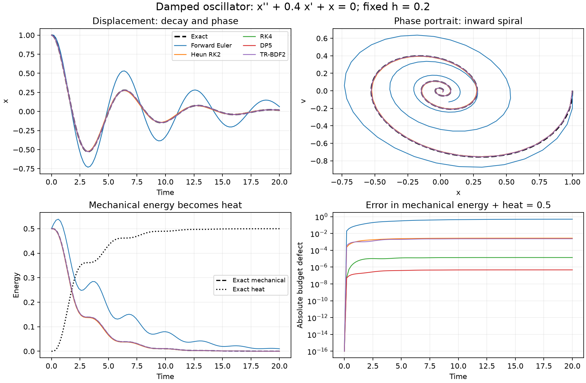
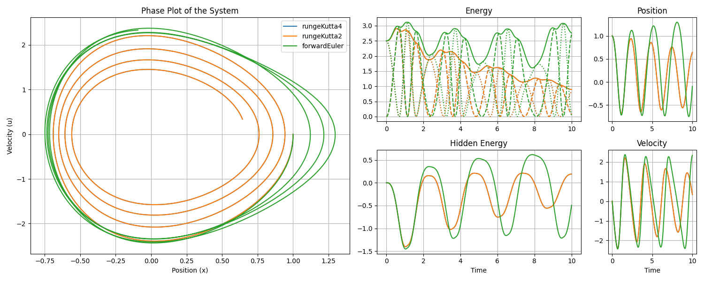
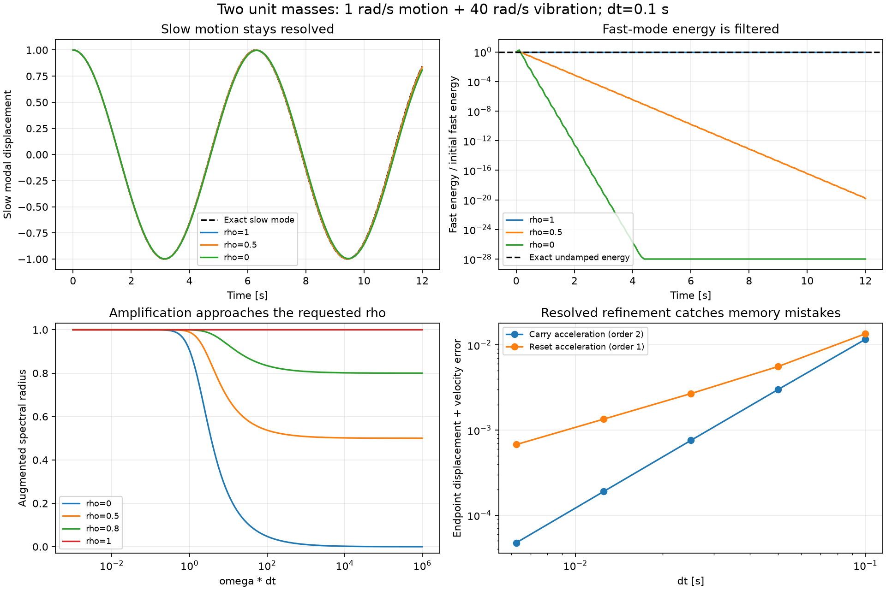
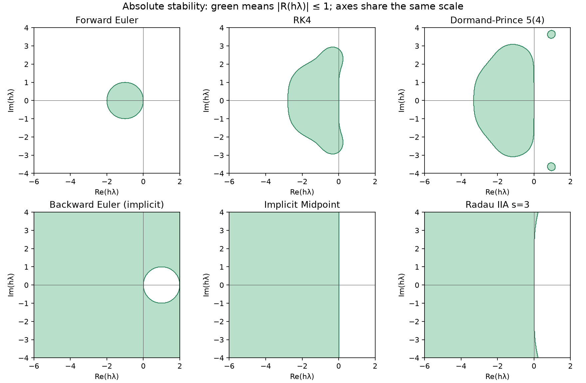
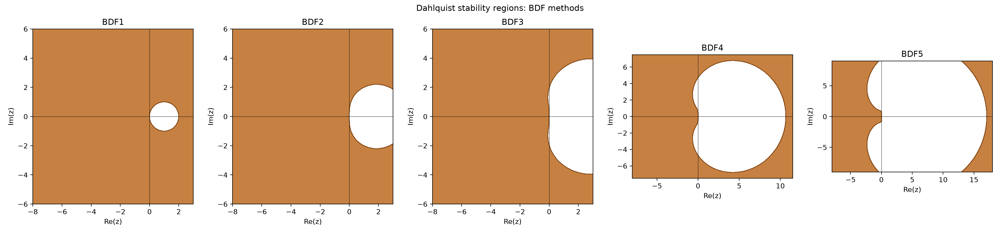
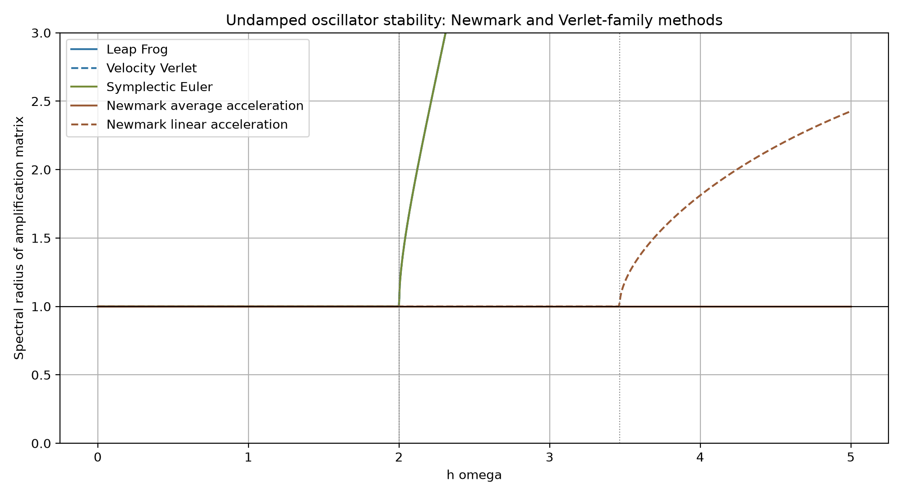

# warpSPHIntegrators

Differentiable time integration for PyTorch, from a single tensor ODE to a
simulation state containing positions, velocities, energy, material parameters,
and temporary buffers. You supply the physical rates; the library supplies the
numerical scheme, implicit solves, and fixed or adaptive stepping.

[catalog:summary:start]: #

**142 registered schemes across 11 families**, with orders through 14 and 47 estimate emitters.

[catalog:summary:end]: #

The choices include explicit Runge–Kutta, SSP/TVD, symplectic splitting, implicit
RK, multistep, IMEX, stabilized explicit, exponential, and structural methods.
Additional parameterized backends extend these families without adding fixed
registry entries. Stepping currently uses PyTorch; native NVIDIA Warp execution
remains future work.

[Run an example](#a-damped-oscillator-you-can-check) ·
[Choose a method](#choosing-a-method) ·
[Understand TVD and geometry](#tvd-ssp-and-symplecticity) ·
[Read stability regions](#stability-regions) ·
[Understand JFNK](#what-jfnk-does-for-an-implicit-method) ·
[See measurements](#benchmark-results) ·
[Browse every scheme](#supported-integrators)

## What is an integration scheme?

For an ODE $y'=f(t,y)$, a scheme converts the rates `f` into a finite step
$y_n\rightarrow y_{n+1}$. Different schemes sample different intermediate states,
combine those samples differently, and sometimes solve equations for unknown
future states. The same physical RHS can therefore be evaluated with several
methods without changing the model.

For example, forward Euler uses the current slope,
$y_{n+1}=y_n+h f(t_n,y_n)$. Heun's second-order method predicts an endpoint with
Euler, samples its slope, and averages the two:

$$
k_1=f(t_n,y_n),\quad k_2=f(t_n+h,y_n+h k_1),\qquad
 y_{n+1}=y_n+\frac h2(k_1+k_2).
$$

| Scheme | Idea | Typical reason to use it |
|---|---|---|
| Forward Euler | One current-state slope | Simple baseline; cheap steps, restrictive stability and accuracy |
| Heun / midpoint RK2 | Two slopes | A small increase in work for second-order accuracy |
| Classical RK4 | Four weighted slopes | Reliable fixed-step baseline for smooth nonstiff problems |
| Dormand–Prince 5(4) | Fifth-order step plus a fourth-order comparison | Adaptive timesteps and supported dense output |
| Backward Euler | Solve $y_{n+1}=y_n+h f(t_{n+1},y_{n+1})$ | Damp rapidly decaying stiff modes |
| Velocity Verlet | Position/velocity drift and kick | Long conservative trajectories with position-only forces |

**Order** describes refinement in the smooth, resolved regime: a method of order
$p$ usually reduces global error by about $2^p$ when the timestep is halved.
It does not promise that a coarse step is stable or that a stiff transient is
accurate. A `5(4)` pair advances the fifth-order solution and uses its difference
from the fourth-order solution to estimate local error. In general the controller
uses the recorded estimate exponent `q`, which can differ from the main order.

## Install

Python 3.11 or newer:

```bash
python -m pip install warpSPHIntegrators
# Current checkout, including test tools:
python -m pip install -e '.[test]'
```

The import name is `warpSPHIntegrators`. NumPy and PyTorch provide the numerical
backend; SciPy is used by some optional benchmarks, rather than the basic tensor
ODE interface. The examples below use float64 on the CPU.

## A damped oscillator you can check

Consider a unit mass on a unit spring with linear drag:

$$
\dot x=v,\qquad \dot v=-x-0.4v,\qquad \dot Q=0.4v^2,
\qquad (x_0,v_0,Q_0)=(1,0,0).
$$

Here $Q$ is heat generated by drag. Mechanical energy
$E_m=(x^2+v^2)/2$ decays, while $E_m+Q=1/2$ is constant in the exact solution.
The displacement and velocity spiral toward zero. This gives three useful checks:
trajectory error, physical dissipation, and the error in the combined energy
budget. Integrating heat as a third field also checks that quantities coupled to
the motion use the scheme's actual stages.

With $\omega_d=\sqrt{0.96}$, the known solution is

$$
x(t)=e^{-0.2t}\left(\cos(\omega_dt)+\frac{0.2}{\omega_d}\sin(\omega_dt)\right),
\quad v(t)=-\frac{e^{-0.2t}}{\omega_d}\sin(\omega_dt),\quad
Q(t)=\tfrac12-\tfrac12(x(t)^2+v(t)^2).
$$

This is a complete runnable example, also saved as
[examples/damped_oscillator.py](examples/damped_oscillator.py):

[example:include examples/damped_oscillator.py]: #
```python
"""Known damped oscillator with generated heat: python examples/damped_oscillator.py."""

import math
import torch
from warpSPHIntegrators import TensorState, tensor_rhs, solve


def rates(t, y):
    x, v, heat = y.unbind(0)
    return torch.stack((v, -x - .4*v, .4*v.square()))


def exact(t):
    omega_d = math.sqrt(.96)
    decay = math.exp(-.2*t)
    x = decay * (math.cos(omega_d*t) + .2/omega_d*math.sin(omega_d*t))
    v = -decay/omega_d * math.sin(omega_d*t)
    return torch.tensor([x, v, .5 - .5*(x*x + v*v)], dtype=torch.float64)


def run_example():
    # State: displacement x, velocity v, and heat generated by drag.
    initial = TensorState(torch.tensor([1., 0., 0.], dtype=torch.float64))
    result = solve('Dormand-Prince 5(4)', initial, 20., tensor_rhs(rates),
                   dt=.2, adaptive=True, rtol=1e-8, atol=1e-10)
    assert result.successful
    assert torch.allclose(result.state.y, exact(20.), atol=2e-8, rtol=0)
    x, v, heat = result.state.y
    assert abs(float(.5*(x*x + v*v) + heat) - .5) < 2e-8
    return result


if __name__ == '__main__':
    result = run_example()
    print(f't={result.state.t:g}, [x, v, heat]={result.state.y.tolist()}, '
          f'accepted={result.accepted_steps}, rejected={result.rejected_steps}')
```

`TensorState` accepts scalar, vector or batched floating-point tensors, and
`tensor_rhs` adapts `f(t, y, ...)` to the integration protocol. `solve` owns
acceptance, rejection, history and compatible stage reuse. For one explicit
step you can instead call `getIntegrator('RK4')(state, dt, rhs)` and read
`result.state`. An embedded pair also returns `result.error`.



The figure compares **fixed** $h=0.2$ steps, whereas the code above adapts its
step. Euler decays too slowly and generates too much heat; RK4 and DP5 follow
the known trajectory much more closely. Even though the heat rate has the correct
physical sign, a generic RK step does not automatically preserve the exact
combined energy budget. The numerical errors and measured work are given below.

For a richer state object, the
[full protocol example](examples/harmonic_oscillator.py) defines tagged positions,
velocities and auxiliary fields. The
[feedback-oscillator notebook](examples/notebooks/integrators.ipynb) extends the
model with energy-dependent feedback and compares phase and energy trajectories:



The feedback model is a separate nonlinear example; the analytic formulas above
apply to the constant-coefficient oscillator.

## Choosing a method

First decide whether stability forces a much smaller step than the motion you
want to resolve. That is the practical sign of **stiffness**. Then look for
structure: conservative mechanics, a known linear operator, a useful
explicit/implicit split, or a diffusion-like negative-real spectrum. Choose order
and error tolerances after those constraints.

| Problem or priority | Start with | What to check |
|---|---|---|
| Smooth, nonstiff, fixed timestep | RK4 | Refine the step and verify the expected fourth-order error reduction |
| Smooth, nonstiff, adaptive timestep | Dormand–Prince 5(4); Bogacki–Shampine 3(2) for a cheaper lower-order pair | Scale `rtol`/`atol` to the fields; DP5 is the currently published dense-output method |
| Advection, shocks, monotonicity | TVD RK2/RK3, SSP RK3, SSPRK(10,4) | The spatial discretization must already have the desired forward-Euler property; respect the SSP CFL limit |
| Long conservative trajectories | Velocity Verlet, PEFRL/VEFRL; Gauss collocation when implicit solves are worthwhile | Separability for drift/kick methods; phase error and a converged solve for implicit geometry |
| General stiff decay | TR-BDF2, ESDIRK3(2)4L[2]SA, Radau IIA | L-stability damps unresolved fast decay; inspect nonlinear-solver termination and total work |
| Stiff dynamics with cheap history | BDF1/BDF2; BDF3–5 if their stability sectors fit the spectrum | Startup costs and history; BDF3–5 are not A-stable |
| Diffusion-like stiffness, avoid nonlinear solves | RKC/RKL; parameterized RKL/RKG backends | A negative-real spectral bound and enough stages; these are not generic oscillatory solvers |
| Expensive RHS, smooth history | Adams–Bashforth / ABM; VariableAdams for changing steps | Thread accepted history in manual loops; startup and restarts can erase the saving |
| Separate explicit and stiff physics | ARK3/ARK4, SBDF2, CNAB2 | Supply a meaningful split; the explicit part still limits the timestep |
| Known semilinear operator $f=Ly+N$ | ETD2RK | Supply the linear action; exponential/Krylov approximation work still matters |
| Frozen-Jacobian approach | ROS3P or EXPRB32 | Operator actions and inner work; ROS3P is A-stable, not L-stable |
| Second-order structural motion | Newmark; GeneralizedAlpha for selective numerical damping | Constant-mass/position-rate contract, parameters, phase error and accepted acceleration history |

**Higher order is a choice about work and error, not an automatic upgrade.**
High-stage methods cost more per step, multistep methods have startup costs,
and implicit methods replace an explicit stability restriction with a solve.
Use a known solution or refinement study before trusting a method on a larger
simulation.

Some practical details matter as much as the method name:

- **Reuse:** FSAL means “first same as last”: an accepted endpoint derivative can
  seed the next step. DP5 normally costs seven RHS entries on its first step and
  six thereafter. Other `priorStep` reuse can lower order; consult `reuse_order`.
- **History:** a manual multistep loop must pass accepted `result.history` into
  the next call. Fixed-coefficient histories restart on changed steps; the
  VariableAdams/NDF backends have distinct step/history policies. `solve` handles
  this threading. Repeated cold starts change both cost and effective behavior.
- **Accuracy:** tolerances describe the chosen error norm, not a guaranteed
  maximum error in every observable. Always examine the physical quantities
  that matter, including phase, heat and constraints.

[example:run readme-discovery]: #
```python
from warpSPHIntegrators import ExplicitRK, filter_schemes, getIntegrator

pairs = filter_schemes(family='ExplicitRK', has_error_estimate=True,
                       supports_reuse=True)
assert any(method.name == 'Dormand-Prince 5(4)' for method in pairs)
scheme = getIntegrator('Dormand-Prince 5(4)')
assert scheme.order == 5 and scheme.embedded_order == 4 and scheme.fsal
# The enum column below gives the exact identifier for a friendly method name.
tsitouras = getIntegrator(ExplicitRK.tsit5)  # Tsitouras 5(4)
assert tsitouras.order == 5 and tsitouras.embedded_order == 4
```

## TVD, SSP and symplecticity

### TVD: avoid creating extra spatial variation

**TVD** means **total variation diminishing**. On a periodic one-dimensional
grid, $TV(u)=\sum_i |u_{i+1}-u_i|$. A TVD step does not increase this quantity.
For an advected discontinuity, that helps prevent spurious oscillations and new
overshoots near the jump. It is a property of the combined spatial and temporal
discretization, rather than a promise made by a time integrator alone.

For positive-speed first-order upwind advection,
$u_i'=-(a/\Delta x)(u_i-u_{i-1})$, forward Euler gives

$$
u_i^{n+1}=(1-\nu)u_i^n+\nu u_{i-1}^n,\qquad
\nu=ah/\Delta x.
$$

When $0\le\nu\le1$, this is a convex combination: it cannot create an overshoot
and is TVD. **SSP**, or **strong stability preserving**, schemes express their
stages as convex combinations of such admissible forward-Euler steps. For
example, TVD RK3 uses

$$
u^{(1)}=u^n+hF(u^n),\quad
u^{(2)}=\tfrac34u^n+\tfrac14\big(u^{(1)}+hF(u^{(1)})\big),\quad
u^{n+1}=\tfrac13u^n+\tfrac23\big(u^{(2)}+hF(u^{(2)})\big).
$$

TVD RK2, TVD RK3 and SSP RK3 have SSP coefficient $C=1$;
SSPRK(10,4) has $C=6$. If forward Euler has the required convex stability
property up to $h_{FE}$, the SSP guarantee applies up to $C h_{FE}$.
It does not repair an oscillatory spatial operator or permit arbitrary timesteps.
Likewise, L-stability does not imply TVD or positivity.

The repository also measures TVD on periodic upwind advection and Burgers tests.
A successful test on one profile is weaker than a general SSP guarantee: a
method can preserve final-step variation in that test while an internal stage
overshoots. [The classifier](benchmarks/tvd_classifier.py) and
[TVD tests](tests/test_tvd.py) distinguish those checks.

### Symplectic: preserve Hamiltonian phase-space structure

A symplectic method preserves the canonical two-form:
$(D\Phi_h)^T\Omega D\Phi_h=\Omega$. For conservative dynamics, this often gives
bounded, oscillating energy error over long resolved runs instead of secular
drift. It does **not** mean exact energy conservation or exact phase. Arbitrary
adaptive timestep changes can also destroy the usual fixed-step geometric
argument.

Velocity Verlet, Leap Frog and the Forest–Ruth compositions PEFRL/VEFRL rely on a
separable Hamiltonian, with position-only forces. In the current implementation,
adding velocity-dependent drag reduces those four methods to first order.
The library's second-order “Symplectic Euler” variant is distinct from the
first-order “Semi-Implicit Euler” and retains second order on the tested damped
problems; damping itself is not Hamiltonian. Implicit midpoint and Gauss
collocation are symplectic when their stage equations are solved accurately.
Trapezoidal and average-acceleration Newmark preserve phase area on the linear
oscillator, which does not establish general nonlinear symplecticity.

The tests check the symplectic form on nonlinear Kepler motion as well as phase
area and energy on oscillators. This is stronger evidence than an energy plot
alone; solve tolerance still matters.

### Physical damping versus numerical damping

The heat in the damped example comes from an explicit physical drag term.
Generalized-alpha instead lets you deliberately suppress unresolved high-frequency
motion numerically. On the known two-mass problem below, the exact undamped modes
have frequencies 1 and 40 rad/s. At $h=0.1$, the slow mode is well resolved and
the fast one is underresolved.



After 12 seconds, Newmark retains both modal energies, but its 40 rad/s mode
oscillates numerically at about 22.14 rad/s. Generalized-alpha with
`rho_inf=.5` retains about 99.947% of the slow energy and suppresses the fast
mode to the numerical floor, with a somewhat larger slow phase lag. Energy
retention therefore cannot stand in for trajectory accuracy. If the fast motion
matters, refine the step. [The structural consumer](docs/docs/structural-demo.md)
includes the model, parameters, source checks and measured solve costs.

## Stability regions

For the scalar test problem $y'=\lambda y$, a one-step method produces
$y_{n+1}=R(z)y_n$, where $z=h\lambda$. Its **absolute stability region** is
$|R(z)|\le1$. The real axis describes pure growth/decay; the imaginary axis
captures undamped oscillation. Increasing $h$ moves a fixed eigenvalue outward
from the origin, so a stable continuous mode can become unstable numerically.

For RK methods with coefficients $A,b$,
$R(z)=1+z b^T(I-zA)^{-1}\mathbf1$. The green areas below show the propagated
solution's stable region, computed from the implemented coefficients on a shared
window. A plot of stability does not show the accuracy within that region.



For example, with $\lambda=-1000$ and $h=.01$, we have $z=-10$:

| Method | Amplification $R(-10)$ | Consequence |
|---|---:|---|
| Exact flow | $e^{-10}\approx4.54\times10^{-5}$ | Rapid physical decay |
| Forward Euler | $-9$ | Unstable: errors grow ninefold and change sign each step |
| Backward Euler | $1/11\approx0.0909$ | Stable and strongly damped, but still inaccurate at this coarse step |
| Implicit midpoint / trapezoidal | $-2/3$ | Stable, but introduces a slowly decaying alternating component |

**A-stable** means the whole left half-plane is stable: any scalar decaying mode
remains bounded for any positive step. **L-stable** adds $R(z)\to0$ in the stiff
limit: very fast decaying modes are actually removed. Backward Euler, TR-BDF2
and Radau IIA are L-stable. Implicit midpoint and Gauss are A-stable but not
L-stable, which suits undamped Hamiltonian motion better than eliminating a fast
relaxation. None of these labels guarantees nonlinear-solver convergence,
accuracy, positivity or stability for every nonnormal operator.

For a multistep method, stability checks all characteristic roots, rather than
one scalar amplification factor. BDF1 and BDF2 are A-stable; BDF3–5 retain a
sector around the negative real axis, narrowing with order. A highly stiff
oscillatory mode can lie outside that sector.



Second-order and split methods need their own diagnostics:

- **Oscillators:** plot the spectral radius of the position/velocity map against
  $h\omega$. For undamped Verlet, use $h\omega<2$ for the bounded regime; the
  repeated-root boundary needs care. Average-acceleration Newmark is stable for
  every $h\omega$ on this linear model, but its phase error can still be large.
  Linear-acceleration Newmark instead has a boundary at $\sqrt{12}$.
- **IMEX:** stability depends on both $z_E=h\lambda_E$ and
  $z_I=h\lambda_I$. An L-stable implicit half does not remove the explicit
  half's restriction. The chosen physical split matters.
- **Stabilized explicit:** a long negative-real interval helps diffusion, while
  giving little protection for a strongly oscillatory spectrum.



[Split stability slices](docs/assets/imex_stability_slices.png) and
[damped oscillator regions](docs/assets/oscillator_stability_damped_newmark_verlet.png)
show the additional parameters. The compact front-page figures are regenerated by
`python benchmarks/readme_gallery.py`; the broader galleries use
`benchmarks/stability_gallery.py` and `benchmarks/oscillator_stability_gallery.py`.

## What JFNK does for an implicit method

**JFNK** means **Jacobian-free Newton–Krylov**. An implicit scheme defines the
numerical equations; JFNK is a way to solve them. For a diagonal RK stage,

$$
F(Y)=Y-\text{base}-h a_{ii} f(t_i,Y)=0.
$$

Newton takes corrections satisfying
$(I-h a_{ii}J_f)\delta=-F(Y)$. GMRES, a Krylov linear solver, approximates that
correction using operator–vector products. “Jacobian-free” means that the full
Jacobian matrix need not be assembled: its action can come from finite
differences or an autograd Jacobian–vector product. Coupled Gauss/Radau methods
solve all stages together in a larger block system.

This matters for large simulations: storing a dense Jacobian is expensive, while
an RHS action may be available directly. It does not make solves free. A
preconditioner approximates an inverse operator to reduce GMRES work; a spatial
preconditioner can matter much more than a local diagonal scaling.

[example:run readme-jfnk]: #
```python
import torch
from warpSPHIntegrators import TensorState, tensor_rhs, getIntegrator

state = TensorState(torch.ones(4, dtype=torch.float64))
rhs = tensor_rhs(lambda t, y: -1000*y)
result = getIntegrator('TR-BDF2')(state, .01, rhs, solver_opts={
    'matvec': 'jvp', 'tol': 1e-12, 'newton_tol': 1e-7,
})
assert result.step_status.tolerance_converged
```

`solver_diagnostics` reports residuals, RHS work, Krylov iterations and
termination. A stagnation exit at a numerical floor is distinguished from
`tolerance_converged`; inspect the status for precision-sensitive work. Tight
solves are particularly important when checking order or geometric properties.
A fixed number of Picard iterations can be cheaper for mild stages, but it does
not inherit the converged implicit method's stiff stability region.

Explicit steps differentiate through PyTorch's graph. Nonlinear implicit drivers
reattach converged solutions through an implicit-function/adjoint solve rather
than storing every Newton iterate. The [solver reference](docs/docs/solver.md)
explains tolerances, finite-difference versus JVP actions, preconditioners and
work diagnostics.

## Benchmark results

The first table uses exactly the oscillator above: CPU float64, one numerical
thread, $T=20$, $h=.2$, 100 accepted steps, initial $(1,0,0)$. Errors are maxima
over saved step endpoints, compared with the analytic trajectory. The recorded
machine is an Intel Core Ultra 9 285K, Python 3.13.14, PyTorch 2.13.0+cu130.
The device is CPU despite the CUDA-enabled PyTorch build.

[readme:oscillator-results:start]: #

| Method | RHS entries | GMRES iterations | Max motion error | Max heat error | Max total-energy defect |
|---|---:|---:|---:|---:|---:|
| Forward Euler | 100 | 0 | 0.255 | 0.492 | 0.501 |
| Heun's Method (2nd order) | 200 | 0 | 0.0127 | 0.00567 | 0.00278 |
| RK4 | 400 | 0 | 2.57e-05 | 1.37e-05 | 1.38e-05 |
| Dormand-Prince 5(4) | 601 | 0 | 1.78e-07 | 4.7e-07 | 4.71e-07 |
| TR-BDF2 | 1,599 | 799 | 0.00302 | 0.00236 | 0.00237 |

[readme:oscillator-results:end]: #

RHS entries count actual calls including solver probes; the separate GMRES column
shows Krylov iterations and should not be added again to these directly counted
calls. TR-BDF2 uses JVP actions with `tol=1e-12`, `newton_tol=1e-7`. This is a
nonstiff problem, so it illustrates why an implicit method need not be economical
when explicit steps are already stable. DP5 uses accepted FSAL reuse. A fixed-grid
comparison demonstrates behavior; it is not an equal-error speed ranking.
[Machine-readable results](docs/development/evidence/readme-oscillator.json) and
[the generator](benchmarks/readme_gallery.py) preserve the settings and measurements.

Other understood consumers exercise different reasons to choose a backend:

| Consumer and settings | Measured result | What it establishes |
|---|---|---|
| Reaction vector, $N=4096$, rates .1–10, $T=1$, adaptive `rtol=1e-8`, `atol=1e-10` | Expanded RDPK3Sp510: 385 RHS entries, max error $2.38\times10^{-11}$; DP5: 511, $4.40\times10^{-11}$ | A high-stage explicit map can earn its cost on a smooth problem; this implementation still stores all stages |
| Same reaction vector/tolerances | Midpoint extrapolation order 10: 351 RHS entries, error $1.50\times10^{-11}$ | A measured niche for high-order extrapolation; columns currently execute serially |
| Varying-stiffness manufactured vector, $N=4096$, peak rate $10^4$, `rtol=1e-7` | DP5/NDF3 switch: 665 RHS entries, error $9.48\times10^{-9}$; DP5 throughout: 21,924, $2.47\times10^{-9}$ | A declared stiffness bound can avoid a severe explicit stability cost; always-NDF3 uses 558 entries here, so switching is not the best of all choices |
| Reaction–diffusion scale gate, $N=64,256,1024$, Gauss/Radau stages 3/4/5/7/9 | All 60 cases pass with at most 10 Krylov iterations and 167.4 MiB additional peak RSS | Schur/shifted spatial preconditioning makes these particular coupled solves practical; this is not an unstructured SPH scaling result |

The underlying records cover
[expanded RK](docs/development/expanded-rk-validation.md),
[extrapolation](docs/development/extrapolation-validation.md),
[method switching](docs/development/algorithm-switch-validation.md), and
[higher collocation](docs/development/higher-collocation-validation.md).
They report their own grids, accuracy measures and source qualifications.
Compare work at the accuracy your application needs; RHS counts, Krylov actions,
allocations and wall time measure different costs.

## Supported integrators

Every fixed registry entry is listed here. These tables are generated from the
runtime catalog by `python scripts/generate_catalog.py`, so new registrations
update the front page as well as the detailed catalog.

Friendly names expand author names and method abbreviations. The enum column
gives the exact member to pass to `getIntegrator`, such as `ExplicitRK.tsit5`
for Tsitouras 5(4). Family enum members share their values with
`IntegrationSchemeType`; existing lookup strings retain their original spelling.

`Order` is the propagated order under the method's assumptions. `Estimate` gives
the main/comparison orders and controller exponent `q`; a dash means no estimate.
Stored stages can include endpoint refresh or companion rows, so they are not
necessarily the RHS count after reuse, nor the cost of an implicit solve.
Stability labels describe the applicable scalar map or stated structural model;
a dash is not a stability guarantee. Symplectic/SSP qualifications above apply.
The KenCarp/ARS **DIRK** entries are their implicit tableaus; use the **IMEX**
entries when supplying both halves of an additive split.

[catalog:schemes:start]: #

### Explicit RK (63)

| Friendly name | Enum member | Order | Stored stages | Estimate | Stability / structure |
|---|---|---:|---|---|---|
| Forward Euler | `ExplicitRK.forwardEuler` | 1 | 1 | — | — |
| Explicit midpoint (Runge–Kutta 2) | `ExplicitRK.rungeKutta2` | 2 | 2 | — | — |
| Heun's Method (2nd order) | `ExplicitRK.heunsMethod` | 2 | 2 | — | — |
| Ralston's Method (2nd order) | `ExplicitRK.ralston2nd` | 2 | 2 | — | — |
| Classical Runge–Kutta 3 | `ExplicitRK.rungeKutta3` | 3 | 3 | — | — |
| Heun's Method (3rd order) | `ExplicitRK.heunsMethod3rd` | 3 | 3 | — | — |
| Ralston's Method (3rd order) | `ExplicitRK.ralston3rd` | 3 | 3 | — | — |
| Wray's Method (3rd order) | `ExplicitRK.wray3rd` | 3 | 3 | — | — |
| Shu–Osher SSP Runge–Kutta 3 | `ExplicitRK.sspRK3` | 3 | 3 | — | SSP under its CFL bound |
| SSP Runge–Kutta (10 stages, order 4) | `ExplicitRK.ssprk104` | 4 | 10 | — | SSP under its CFL bound |
| SSP Runge–Kutta (5 stages, order 3) | `ExplicitRK.ssprk53` | 3 | 5 | — | SSP under its CFL bound |
| SSP Runge–Kutta (6 stages, order 3) | `ExplicitRK.ssprk63` | 3 | 6 | — | SSP under its CFL bound |
| SSP Runge–Kutta (7 stages, order 3) | `ExplicitRK.ssprk73` | 3 | 7 | — | SSP under its CFL bound |
| SSP Runge–Kutta (8 stages, order 3) | `ExplicitRK.ssprk83` | 3 | 8 | — | SSP under its CFL bound |
| SSP Runge–Kutta (5 stages, order 4) | `ExplicitRK.ssprk54` | 4 | 5 | — | SSP under its CFL bound |
| Kubatko–Yeager–Ketcheson SSP RK2 (4 stages) | `ExplicitRK.kykssprk42` | 2 | 4 | — | — |
| Kubatko–Yeager–Ketcheson DG SSP RK2 (3 stages) | `ExplicitRK.kyk2014dgssprk3s2` | 2 | 3 | — | — |
| SSP Runge–Kutta 3(2) (4 stages, comparison 1) | `ExplicitRK.ssprk43` | 3 | 4 | 3(2), q=3 | SSP under its CFL bound |
| SSP Runge–Kutta 3(2) (4 stages, comparison 2) | `ExplicitRK.ssprk432` | 3 | 4 | 3(2), q=3 | SSP under its CFL bound |
| SSP Runge–Kutta 3 (9 stages) | `ExplicitRK.ssprk932` | 3 | 9 | — | SSP under its CFL bound |
| Higueras–Roldán SSP RK3 (2N1 variant) | `ExplicitRK.ssprk53_2n1` | 3 | 5 | — | SSP under its CFL bound |
| Higueras–Roldán SSP RK3 (2N2 variant) | `ExplicitRK.ssprk53_2n2` | 3 | 5 | — | SSP under its CFL bound |
| Higueras–Roldán SSP RK3 (H variant) | `ExplicitRK.ssprk53_h` | 3 | 5 | — | SSP under its CFL bound |
| Classical Runge–Kutta 4 | `ExplicitRK.rungeKutta4` | 4 | 4 | — | — |
| Runge–Kutta 4 (3/8 rule) | `ExplicitRK.rungeKutta4alt` | 4 | 4 | — | — |
| Nyström Runge–Kutta 5 | `ExplicitRK.nystrom5th` | 5 | 6 | — | — |
| Bogacki–Shampine 3(2) | `ExplicitRK.bogackiShampine` | 3 | 4 | 3(2), q=3; FSAL | — |
| Dormand–Prince 5(4) | `ExplicitRK.dormandPrince` | 5 | 7 | 5(4), q=5; FSAL | — |
| Cash–Karp 5(4) | `ExplicitRK.cashKarp` | 5 | 6 | 5(4), q=5 | — |
| Tsitouras 5(4) | `ExplicitRK.tsit5` | 5 | 7 | 5(4), q=5; FSAL | — |
| Owren–Zennaro 3(2) | `ExplicitRK.owrenzen3` | 3 | 4 | 3(2), q=3; FSAL | — |
| Owren–Zennaro 4(3) | `ExplicitRK.owrenzen4` | 4 | 6 | 4(3), q=4; FSAL | — |
| Owren–Zennaro 5(4) | `ExplicitRK.owrenzen5` | 5 | 8 | 5(4), q=5; FSAL | — |
| Bogacki–Shampine 5(4) | `ExplicitRK.bs5` | 5 | 8 | 5(4), q=5; FSAL | — |
| Stepanov 5(4) (7 stages) | `ExplicitRK.stefanov5` | 5 | 7 | 5(4), q=5; FSAL | — |
| Alshina–Zaks–Kalitkin 2(1) | `ExplicitRK.arushina2` | 2 | 2 | 2(1), q=2 | — |
| Alshina–Zaks–Kalitkin 3 | `ExplicitRK.arushina3` | 3 | 3 | — | — |
| Alshina–Zaks–Kalitkin 6 | `ExplicitRK.arushina6` | 6 | 7 | — | — |
| Stepanov 5 (9 stages) | `ExplicitRK.msrk5` | 5 | 9 | —; FSAL | — |
| Stepanov 6 (9 stages) | `ExplicitRK.msrk6` | 6 | 9 | —; FSAL | — |
| Kovalnogov–Simos–Tsitouras 5 (SIR method) | `ExplicitRK.sir54` | 5 | 8 | —; FSAL | — |
| Ralston Runge–Kutta 4 | `ExplicitRK.raston4` | 4 | 4 | — | — |
| Runge–Kutta–Oliver 5 (6 stages) | `ExplicitRK.rko65` | 5 | 6 | — | — |
| Mead–Renaut Runge–Kutta 3 | `ExplicitRK.rkm` | 3 | 6 | — | — |
| Pseudo-symplectic Runge–Kutta 4 (6 stages) | `ExplicitRK.psrk4p7q6` | 4 | 6 | — | — |
| Pseudo-symplectic Runge–Kutta 3 (5 stages) | `ExplicitRK.psrk3p6q5` | 3 | 5 | — | — |
| Pseudo-symplectic Runge–Kutta 3 (4 stages) | `ExplicitRK.psrk3p5q4` | 3 | 4 | — | — |
| Verner 6(5) | `ExplicitRK.vern6` | 6 | 9 | 6(5), q=6; FSAL | — |
| Verner 7(6) | `ExplicitRK.vern7` | 7 | 10 | 7(6), q=7 | — |
| Verner 8(7) | `ExplicitRK.vern8` | 8 | 13 | 8(7), q=8 | — |
| Verner 9(8) | `ExplicitRK.vern9` | 9 | 16 | 9(8), q=9 | — |
| Verner 7(6) (RKV76.IIa) | `ExplicitRK.rkv76iia` | 7 | 10 | 7(6), q=7 | — |
| Tanaka–Muramatsu–Yamashita 7(6) | `ExplicitRK.tanyam7` | 7 | 10 | 7(6), q=7 | — |
| Tsitouras–Papakostas 8(7) | `ExplicitRK.tsitpap8` | 8 | 13 | 8(7), q=8 | — |
| Dormand–Prince 8 | `ExplicitRK.dp8` | 8 | 12 | — | — |
| Feagin Runge–Kutta 10 | `ExplicitRK.feagin10` | 10 | 17 | — | — |
| Feagin Runge–Kutta 12 | `ExplicitRK.feagin12` | 12 | 25 | — | — |
| Feagin Runge–Kutta 14 | `ExplicitRK.feagin14` | 14 | 35 | — | — |
| Evaluate–predict–evaluate–correct (midpoint) | `ExplicitRK.epec` | 2 | 2 | — | — |
| Evaluate–predict–evaluate–correct (Heun) | `ExplicitRK.epecModified` | 2 | 2 | — | — |
| TVD Runge–Kutta 3 (Shu–Osher) | `ExplicitRK.tvdRK3` | 3 | 3 | — | SSP under its CFL bound |
| TVD Runge–Kutta 2 (Shu–Osher) | `ExplicitRK.tvdRK2` | 2 | 2 | — | SSP under its CFL bound |
| Explicit Euler | `ExplicitRK.explicitEuler` | 1 | 1 | — | — |

### Symplectic (6)

| Friendly name | Enum member | Order | Stored stages | Estimate | Stability / structure |
|---|---|---:|---|---|---|
| Leapfrog (synchronized) | `Symplectic.leapFrog` | 2 | driver | — | symplectic for separable Hamiltonians |
| Symplectic Euler | `Symplectic.symplecticEuler` | 2 | driver | — | symplectic for separable Hamiltonians |
| Velocity Verlet | `Symplectic.velocityVerlet` | 2 | driver | — | symplectic for separable Hamiltonians |
| Forest–Ruth 4 (position-first, PEFRL) | `Symplectic.pefrl` | 4 | driver | — | symplectic for separable Hamiltonians |
| Forest–Ruth 4 (velocity-first, VEFRL) | `Symplectic.vefrl` | 4 | driver | — | symplectic for separable Hamiltonians |
| Semi-Implicit Euler | `Symplectic.semiImplicitEuler` | 1 | 1 | — | symplectic for separable Hamiltonians |

### Relaxed Chebyshev (3)

| Friendly name | Enum member | Order | Stored stages | Estimate | Stability / structure |
|---|---|---:|---|---|---|
| Runge–Kutta–Chebyshev 1 | `RelaxedChebyshev.rkc1` | 1 | variable | — | — |
| Runge–Kutta–Chebyshev 2 | `RelaxedChebyshev.rkc2` | 2 | variable | — | — |
| Runge–Kutta–Legendre 2 | `RelaxedChebyshev.rkl2` | 2 | variable | — | — |

### Multistep explicit (10)

| Friendly name | Enum member | Order | Stored stages | Estimate | Stability / structure |
|---|---|---:|---|---|---|
| Adams-Bashforth 2 | `MultistepExplicit.ab2` | 2 | driver | — | history required |
| Adams-Bashforth 3 | `MultistepExplicit.ab3` | 3 | driver | — | history required |
| Adams-Bashforth 4 | `MultistepExplicit.ab4` | 4 | driver | — | history required |
| Adams-Bashforth 5 | `MultistepExplicit.ab5` | 5 | driver | — | history required |
| Adams-Bashforth-Moulton 2 (PECE) | `MultistepExplicit.abm2` | 2 | driver | — | history required |
| Adams-Bashforth-Moulton 3 (PECE) | `MultistepExplicit.abm3` | 3 | driver | — | history required |
| Adams-Bashforth-Moulton 4 (PECE) | `MultistepExplicit.abm4` | 4 | driver | — | history required |
| Adams-Bashforth-Moulton 5 (PECE) | `MultistepExplicit.abm5` | 5 | driver | — | history required |
| SSP multistep (3 steps, order 2) | `MultistepExplicit.ssprkmsvs32` | 2 | driver | — | SSP under step/history bounds; history required |
| SSP multistep (4 steps, order 3) | `MultistepExplicit.ssprkmsvs43` | 3 | driver | — | SSP under step/history bounds; history required |

### DIRK (37)

| Friendly name | Enum member | Order | Stored stages | Estimate | Stability / structure |
|---|---|---:|---|---|---|
| Backward Euler (implicit) | `DIRK.backwardEuler` | 1 | 1 | — | L |
| Implicit Midpoint | `DIRK.implicitMidpoint` | 2 | 1 | — | A; symplectic with converged solves |
| Trapezoidal (Crank-Nicolson) | `DIRK.trapezoidal` | 2 | 2 | —; FSAL | A; linear oscillator area preservation |
| Singly diagonally implicit Runge–Kutta 2 | `DIRK.sdirk2` | 2 | 2 | — | L |
| Trapezoidal rule–BDF2 (TR-BDF2) | `DIRK.trbdf2` | 2 | 3 | 2(3), q=3; FSAL | L |
| Explicit-first-stage SDIRK 3(2) (4 stages) | `DIRK.esdirk324l2sa` | 3 | 4 | 3(2), q=3; FSAL | L |
| Explicit-first-stage SDIRK 4(3) (6 stages) | `DIRK.esdirk436l2sa` | 4 | 6 | 4(3), q=4; FSAL | L |
| Kværnø 3(2) | `DIRK.kvaerno3` | 3 | 4 | 3(2), q=3; FSAL | L |
| Kværnø 4(3) | `DIRK.kvaerno4` | 4 | 5 | 4(3), q=4; FSAL | A |
| Kværnø 5(4) | `DIRK.kvaerno5` | 5 | 7 | 5(4), q=5; FSAL | L |
| Kennedy–Carpenter 3(2) (4 stages, KenCarp3) | `DIRK.kencarp3` | 3 | 4 | 3(2), q=3; FSAL | L |
| Kennedy–Carpenter 4(3) (6 stages, KenCarp4) | `DIRK.kencarp4` | 4 | 6 | 4(3), q=4; FSAL | L |
| Kennedy–Carpenter 4(3) (7 stages, KenCarp47) | `DIRK.kencarp47` | 4 | 7 | 4(3), q=4; FSAL | L |
| Kennedy–Carpenter 5(4) (8 stages, KenCarp5) | `DIRK.kencarp5` | 5 | 8 | 5(4), q=5; FSAL | L |
| Kennedy–Carpenter 5(4) (8 stages, KenCarp58) | `DIRK.kencarp58` | 5 | 8 | 5(4), q=5; FSAL | L |
| Explicit-first-stage SDIRK 3(2) (5 stages) | `DIRK.esdirk325l2sa` | 3 | 5 | 3(2), q=3; FSAL | L |
| Explicit-first-stage SDIRK 4(3) (6 stages, variant 2) | `DIRK.esdirk436l2sa2` | 4 | 6 | 4(3), q=4; FSAL | L |
| Explicit-first-stage SDIRK 4(3) (7 stages) | `DIRK.esdirk437l2sa` | 4 | 7 | 4(3), q=4; FSAL | L |
| Explicit-first-stage SDIRK 5(4) (7 stages, variant 2) | `DIRK.esdirk547l2sa2` | 5 | 7 | 5(4), q=5; FSAL | L |
| Explicit-first-stage SDIRK 5(4) (8 stages, I variant) | `DIRK.esdirk54i8l2sa` | 5 | 8 | 5(4), q=5; FSAL | L |
| Explicit-first-stage SDIRK 6(5) (9 stages) | `DIRK.esdirk659l2sa` | 6 | 9 | 6(5), q=6; FSAL | L |
| SSP singly diagonally implicit Runge–Kutta 2 | `DIRK.sspsdirk2` | 2 | 2 | — | A; SSP under its CFL bound |
| Ascher–Ruuth–Spiteri (ARS222, implicit part) | `DIRK.ars222` | 2 | 3 | —; FSAL | L |
| Ascher–Ruuth–Spiteri (ARS232, implicit part) | `DIRK.ars232` | 2 | 3 | —; FSAL | L |
| Ascher–Ruuth–Spiteri (ARS343, implicit part) | `DIRK.ars343` | 3 | 4 | —; FSAL | L |
| Ascher–Ruuth–Spiteri (ARS443, implicit part) | `DIRK.ars443` | 3 | 5 | —; FSAL | L |
| Boscarino–Russo 3 (BHR553, implicit part) | `DIRK.bhr553` | 3 | 5 | —; FSAL | L |
| Cash SDIRK 4(3) | `DIRK.cash4` | 4 | 5 | 4(3), q=4 | L |
| Calvo–de Frutos–Novo 3 (implicit part) | `DIRK.cfnlirk3` | 3 | 4 | —; FSAL | L |
| Hairer–Wanner SDIRK 4(3) (variant 1) | `DIRK.hairer4` | 4 | 5 | 4(3), q=4 | L |
| Hairer–Wanner SDIRK 4(3) (variant 2) | `DIRK.hairer42` | 4 | 5 | 4(3), q=4 | L |
| Ferracina–Spijker SDIRK 4 (4 stages) | `DIRK.sfstdirk4` | 4 | 4 | — | — |
| Ferracina–Spijker SDIRK 4 (5 stages) | `DIRK.sfstdirk5` | 4 | 5 | — | — |
| Ferracina–Spijker SDIRK 4 (6 stages) | `DIRK.sfstdirk6` | 4 | 6 | — | — |
| Ferracina–Spijker SDIRK 4 (7 stages) | `DIRK.sfstdirk7` | 4 | 7 | — | — |
| Ferracina–Spijker SDIRK 4 (8 stages) | `DIRK.sfstdirk8` | 4 | 8 | — | — |
| Modified extended backward differentiation 2 | `DIRK.mebdf2` | 2 | 3 | — | L |

### Coupled RK (4)

| Friendly name | Enum member | Order | Stored stages | Estimate | Stability / structure |
|---|---|---:|---|---|---|
| Gauss–Legendre collocation (2 stages) | `CoupledRK.gaussLegendre2` | 4 | 2 + 1 | 4(2), q=3 | A; symplectic with converged solves |
| Radau IIA collocation (2 stages) | `CoupledRK.radauIia2` | 3 | 2 + 1 | 3(2), q=3 | L |
| Gauss–Legendre collocation (3 stages) | `CoupledRK.gaussLegendre3` | 6 | 3 | 6(2), q=3 | A; symplectic with converged solves |
| Radau IIA collocation (3 stages) | `CoupledRK.radauIia3` | 5 | 3 + 1 | 5(3), q=4 | L |

### Multistep implicit (8)

| Friendly name | Enum member | Order | Stored stages | Estimate | Stability / structure |
|---|---|---:|---|---|---|
| Backward differentiation formula 1 | `MultistepImplicit.bdf1` | 1 | driver | — | L; history required |
| Backward differentiation formula 2 | `MultistepImplicit.bdf2` | 2 | driver | — | A; history required |
| Backward differentiation formula 3 | `MultistepImplicit.bdf3` | 3 | driver | — | A(alpha); history required |
| Backward differentiation formula 4 | `MultistepImplicit.bdf4` | 4 | driver | — | A(alpha); history required |
| Backward differentiation formula 5 | `MultistepImplicit.bdf5` | 5 | driver | — | A(alpha); history required |
| Adams-Moulton 2 (implicit) | `MultistepImplicit.am2` | 2 | driver | — | A; history required |
| Adams-Moulton 3 (implicit) | `MultistepImplicit.am3` | 3 | driver | — | history required |
| Adams-Moulton 4 (implicit) | `MultistepImplicit.am4` | 4 | driver | — | history required |

### IMEX (7)

| Friendly name | Enum member | Order | Stored stages | Estimate | Stability / structure |
|---|---|---:|---|---|---|
| Kennedy–Carpenter additive RK 3(2) (4 stages) | `IMEX.ark324l2sa` | 3 | 4 | 3(2), q=3 | implicit part: L |
| Kennedy–Carpenter additive RK 4(3) (6 stages) | `IMEX.ark436l2sa` | 4 | 6 | 4(3), q=4 | implicit part: L |
| Implicit–explicit Euler | `IMEX.imexEuler` | 1 | driver | — | implicit part: A |
| Semi-implicit backward differentiation 2 | `IMEX.sbdf2` | 2 | driver | — | implicit part: L; history required |
| Semi-implicit backward differentiation 3 | `IMEX.sbdf3` | 3 | driver | — | implicit part: A(alpha); history required |
| Crank–Nicolson–Adams–Bashforth 2 | `IMEX.cnab2` | 2 | driver | — | implicit part: A; history required |
| Crank–Nicolson–leapfrog 2 | `IMEX.cnlf2` | 2 | driver | — | implicit part: A; history required |

### Linearly implicit (1)

| Friendly name | Enum member | Order | Stored stages | Estimate | Stability / structure |
|---|---|---:|---|---|---|
| Rosenbrock–W 3(2) (ROS3P) | `LinearlyImplicit.ros3p` | 3 | 3 | 3(2), q=3 | A |

### Exponential (2)

| Friendly name | Enum member | Order | Stored stages | Estimate | Stability / structure |
|---|---|---:|---|---|---|
| Exponential time-differencing Runge–Kutta 2 | `Exponential.etd2rk` | 2 | 2 | — | linear test: L |
| Exponential Rosenbrock 3(2) | `Exponential.exprb32` | 3 | 2 | 3(2), q=3 | linear test: L |

### Newmark (1)

| Friendly name | Enum member | Order | Stored stages | Estimate | Stability / structure |
|---|---|---:|---|---|---|
| Newmark (average acceleration by default) | `Newmark.newmark` | 2 | driver | — | bounded linear oscillator (default parameters); linear oscillator area preservation |

[catalog:schemes:end]: #

### Parameterized backends and compositions

These have their own runtime factories and are additional to the 142 fixed
entries. They use the same state/result and run infrastructure where their
contracts allow it.

| Factory | Available configurations | Purpose and qualification |
|---|---|---|
| `Collocation` | Gauss / Radau, 2–9 stages | Orders $2s$ / $2s-1$, coupled implicit solves; high orders can reach binary64/solve floors |
| `GeneralizedAlpha` | `rho_inf` in [0,1] | Second-order constant-mass mechanics with selective high-frequency damping and accepted acceleration history |
| `VariableAdams` / `AdaptiveAdams` | AB / ABM orders 3–5; accepted PECE target-order selection | Variable-step history and ramped comparison control; bounded adaptive-order policy |
| `StabilizedRK` | RKL1/2, RKG1/2 | Supplied stages or negative-real spectral bound; full-stage storage |
| `Nystrom` | 14 qualified VI/VD configurations | Second-order mechanics with position/velocity/quantity quadratures; structure assumptions are checked or declared |
| `ImprovedNystrom` | Improved Nyström orders 3 and 4 | Fixed-step velocity-independent mechanics; corrected startup and owned history reduce warm-step force calls |
| `ParallelDIRK` | Parallel DIRK, four stages / order four | L-stable ordinary ODE map, executed serially; four nonlinear solves and no embedded estimate |
| `NDF` / `AdaptiveNDF` | Fixed target 1–5 / accepted target-order selection | Implicit difference history with quasi-constant step policy; distinct from the full upstream controller |
| `Extrapolation` | Euler 2–8; midpoint 2/4/6/8/10 | Fixed-target explicit extrapolation, adaptive timestep, full-state quantities |
| `ExpandedRK` | 54 checked main maps, 19 estimates | Source-expanded low-storage-family coefficients; current execution uses full-stage buffers |
| `AlgorithmSwitch` | Declared child methods and a pure selector | Owned active-child history, cold starts on transitions, accepted control delegation |
| `FunctionMap` | A supplied complete state map | Discrete transitions, such as a known analytic flow; no general ODE order or error estimate |
| `LieTrotter` / `Strang` / `Yoshida4` | Declared conservative/dissipative or Hamiltonian flows | Physical operator composition; negative substeps and reversibility requirements restrict Yoshida4 |

[Family guides](docs/docs/index.md) describe the exact configuration names and
interfaces. The [method disposition ledger](docs/plans/method-dispositions.md)
records source pins, equivalences and excluded/deferred source formulas; a source
method name alone does not certify a usable implementation or comparison pair.

## Simulation state and current boundaries

A plain tensor is enough for ordinary ODEs. For a physical simulation, fields can
carry different behavior through the state protocol:

| Field behavior | Role | Example |
|---|---|---|
| `integrated` | Advanced using stage rates | Position, velocity, thermal energy |
| `constant` | Retained across the step | Mass, material parameters |
| `copied` | Refreshed from the last stage | Pressure or density computed from the stage state |
| `ephemeral` | Temporary stage data | Scratch buffers and neighbour information |
| `custom` | Application-defined lifecycle | A specialized quantity update |

This separates the numerical method from the application's force evaluation and
state management. Particle masking belongs to the system/RHS. Stateful methods
must resume their accepted state and history together. The runner isolates
rejected attempts; external effects require application transaction hooks.
Portable tensor checkpoints are available; custom systems provide their own
serialization. Dense output and event localization are method-dependent.

Current gates include source/forced-time order checks, nonlinear geometric tests,
parameter/state gradients, lifecycle ownership, adaptive rollback, portable
restart and installed-wheel smoke tests. The latest full CPU backend gate passes
8,139 tests with 639 skips on eight workers. That evidence does not establish
native Warp buffers, universal SPH conservation, or a preconditioner for every
large operator.

## Documentation and development

- [Documentation site](https://fluids.dev/warpSPHIntegrators/),
  [quick start](docs/docs/quickstart.md), [API](docs/docs/api.md),
  [run orchestration](docs/docs/runs.md) and [options](docs/docs/options.md).
- [Examples and notebooks](examples/README.md),
  [detailed protocol examples and galleries](docs/development/usage-reference.md),
  and [benchmarks](benchmarks/README.md).
- [Contributor instructions](CONTRIBUTING.md): environment, multicore tests,
  registration, coefficient provenance and release checks.
- [Current execution plan](REPOSITORY_PLAN.md),
  [developer index](docs/development/README.md), and
  [numerical evidence index](docs/research/integrators/notes-index.md).

## License and citation

[Apache 2.0](license.md). If used in research:

```bibtex
@software{warpSPHIntegrators2024,
  title={Differentiable ODE Integration with PyTorch},
  author={Winchenbach, Rene},
  url={https://github.com/wi-re/warpSPHIntegrators},
  year={2024}
}
```
