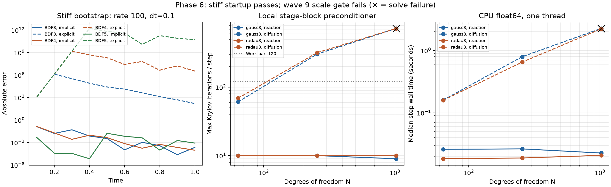

# Phase 6 stiff startup and coupled scale gate — 14 October 2026

Phase 6 completes the startup correction and evaluates the hard wave 9 gate.
Implementation, tests and reproducible benchmark tools are committed in `62a99a5`.
**The gate fails on mesh-refined diffusion, so the registry remains at 137.**
Three-stage candidates are research prototypes, not public registered methods.
The failure is recorded explicitly rather than treating a scalar solve as a
scale proof. A spatial/field-aware preconditioner must clear the same bar before
wave 9 reopens.

## Order-preserving BDF startup

BDF3/4/5 use existing order-3 ESDIRK3(2)4L[2]SA, order-4 KenCarp4
and order-5 KenCarp5 respectively until state-snapshot history fills. Each is
L-stable with stage times inside the step; a fixed number of startup steps of order p produces O(h^(p+1))
initialization errors and does not cap the BDF-p trajectory's formal order.
BDF2 retains its old DP5 default and can select TR-BDF2 with `startup='implicit'`.
`startup='explicit'` preserves the old BDF3–5 comparison path. Starter diagnostics
are retained; failed solves are rejected by the run API. BDF rejects undersized
history and clears a changed step before consuming old snapshots. Each starter
retains one outer lifecycle call and gradient connections. SBDF without an
explicit part delegates to BDF, preserving its exact pure-implicit limit;
actual IMEX splits and AM retain their existing DP5 startup.

The target problem has rate 100, phi(t)=sin(4t), y(0)=1 and
`y'=-100*(y-phi)+phi'`, exact `phi(t)+exp(-100*t)`. Uniform steps are
0.1, 0.05, 0.025, 0.0125 and 0.00625 through t=1. Tight JVP-based solves
separate truncation error from the Newton floor. At h=0.1, implicit startup
keeps every BDF3–5 peak amplitude below two; DP5 amplifies the transient by
orders of magnitude. The finest-grid measured orders are:

| Scheme | Rate-100 implicit starter | Rate-1 decay implicit starter | Rate-1 decay BE warm-up control |
|---|---:|---:|---:|
| BDF3 | 2.955 | 2.985 | 1.996 |
| BDF4 | 4.056 | 3.982 | 1.994 |
| BDF5 | 4.925 | 4.979 | 1.994 |

The rate-1 control uses phi=0 and y(0)=1, so startup errors survive through t=1.
It demonstrates the approximately second-order cap caused by a fixed number
of BE warm-up steps. On the rate-100 problem, strong damping can erase startup
errors and obscure this cap; that is why both experiments are retained. None
of these checks promises uniform full order as stiffness tends to infinity or
widens the BDF3–5 A(alpha) stability cones.

## Warm guesses and preconditioning

DIRK's optional `warmStart=StageResult` predicts its implicit first stage from
a previous derivative; explicit-first tableaus refuse it. Coupled RK already
accepts a full previous-stage list. These change the initial guess only, not
the formula or derivative reuse. SDIRK2's reaction sweep shows warm guesses
increase median RHS work from 22 to 25–26 calls/step and median time by about
14–23%. Coupled warm guesses likewise provide no consistent reduction.
They remain opt-in, with a concrete benchmark consumer; no automatic policy
or speedup is claimed.

DIRK preconditioner context includes dt, stage index/time and dt*a_ii; coupled
context includes dt, A and stage times. Driver-owned values override user keys.
`stage_block_preconditioner` uses a user-provided per-stage integrated Jacobian
diagonal to factor `I-dt*A*diag(J)` independently per DOF. It retains stage
coupling, omits spatial/field coupling and caches O(s²N) LU data within one
Newton iterate. It is a forward-solve preconditioner; the existing adjoint is
unchanged. Tests compare its action with exact small block matrices, solution
parity and state/RHS-parameter gradients.

## Three-stage prototypes, provenance and nomenclature

[The prototype](../../benchmarks/collocation_prototypes.py) integrates Lagrange
basis polynomials at shifted Gauss nodes `(1/2-sqrt(15)/10,1/2,1/2+sqrt(15)/10)`
and Radau nodes `((4-sqrt(6))/10,(4+sqrt(6))/10,1)`. This follows the
[primary collocation derivation](https://www.unige.ch/~hairer/preprints/coimbra.pdf),
not a transcription of an unverified cache. The tests verify polynomial
collocation identities, orders six/five on a nonlinear flow, LHP stability,
Radau stiff accuracy/L-damping, Gauss symplectic and time-reversal identities,
and state/parameter gradients through preconditioned solves.

The Gauss RK method's symmetry is a time-reversal identity, distinct from the
matrix identity A=A^T. The existing two-stage documentation conflated these;
the current family guide now states the correct identities. No companion
estimate is invented for the prototypes: companion_b=None returns error=None.
Existing two-stage companions remain unchanged. Registration still needs a
verified companion design/rate and the other full catalog gates.

[Upstream primary documentation](https://docs.sciml.ai/OrdinaryDiffEq/stable/implicit/FIRK/)
uses RadauIIA3/5/9 for propagated orders, hence stages 2/3/5. The historical
wave 9 list incorrectly treated them as stage counts. Gauss s=3/4/5 corresponds
to orders 6/8/10; Radau s=4/9 would mean orders 7/17 and cannot be inferred
from those names. Current documentation resolves naming only; it is not a
new coefficient oracle for the pinned OrdinaryDiffEq 7.8.1 source. Future
transcription must re-enumerate that source before claiming coverage.

## Predeclared scale bar and measured result

`benchmarks/implicit_scale.py` runs **114 configurations in fresh processes**:
N=64/256/1024; two- and three-stage Gauss/Radau with no preconditioner, a
per-stage diagonal or stage-block preconditioner, and cold/warm guesses;
SDIRK2 provides a sequential-stage baseline. Two nonlinear vector problems use
rates log-spaced from 1 to 10,000, cubic reaction and periodic nearest-neighbor
coupling. Reaction uses coupling 0.2; diffusion uses 0.02*N², exposing mesh
refinement rather than keeping the spatial operator artificially mild.

The cold stage-block s=3 gate was declared before running: every step must
meet tolerance, at most **120 total Krylov iterations/step**, at most **3x**
matching s=2 median wall time and measured RHS work, at most **256 MiB**
additional peak process RSS, through N>=1024. Restart=30, per-Newton linear
budget=120, Newton budget=6, GMRES tolerance=1e-10 and scaled nonlinear
threshold=1e-6. Three steps, two repetitions, fixed h=0.05. The work bar is
a local engineering threshold, not an upstream mathematical guarantee.

| Problem / N | Gauss s=3 max Krylov/step | Radau s=3 max Krylov/step | Gate |
|---|---:|---:|---|
| reaction / 64 | 10 | 10 | passes |
| reaction / 256 | 10 | 10 | passes |
| reaction / 1024 | 9 | 10 | passes |
| diffusion / 64 | 61 | 69 | passes |
| diffusion / 256 | 304 | 319 | work bar fails |
| diffusion / 1024 | 720 | 720 | solve fails |

Reaction passes every size: s=3 takes about 1.33–1.66x matching s=2 time
and 1.32–1.45x RHS work with the block preconditioner. Diffusion at N=256
converges but exceeds the work bar; N=1024 exhausts the tolerance/budget,
including s=2 baselines. Failed N=1024 s=3 configurations stop after their
first attempted step on each repetition (2/2 failures); they are not useful
completed trajectories. The benchmark records residuals, failure rates,
actual Krylov iterations, counted RHS calls, Newton-map work and wall time.
Block diagnostics historically multiply Krylov counts by s; the report divides
those counts back to actual iterations and measures RHS calls independently.

Peak process RSS is measured with Linux ru_maxrss in each fresh process,
with a baseline after native thread-pool initialization. Across all configurations
it reaches about 653 MiB; the largest additional peak is about 152 MiB.
This includes first-use AD/library allocation, not just preconditioner storage
and not merely Python allocations. The memory bar passes; solve/work scaling
is the blocker. Timing is a local CPU comparison, not a GPU/downstream SPH claim.
Hardware: Intel Core Ultra 9 285K; Python 3.13.14, Torch 2.13.0+cu130 on CPU,
float64, one numerical thread. No comparisons with Julia performance are claimed.



## Validation and reproduction

The initial focused family/solver sweep passes **518 tests**; the final added-test,
IMEX and runner sweep passes **87 tests** after preserving the SBDF pure-implicit
startup contract. The bounded-node refinement and updated historical checks pass
**1,231 tests, 45 skipped**, plus all three legacy-startup CFL controls. **25 new regression cases** cover startup/order/lifecycle/
gradients, custom failure/history guards, collocation properties, warm guesses,
context and stage-block correctness. The installed-wheel gate passes the new
stiff BDF5 bootstrap and preconditioner alongside all previous contracts.

The first full gate had nine failures: the historical RHS golden needed the
explicit compatibility mode, the generic history test supplied insufficient
capacity, two bootstrap methods used out-of-step nodes, and four cold-call TVD
verdicts still recorded DP5. KenCarp4/5 preserve bounded stage times without
widening that test; compatibility/CFL controls retain the old explicit behavior.
The new TVD measurements describe cold starters, not a theorem for full BDF
trajectories. Numerical convergence criteria were not relaxed.

The final full CPU gate passes: **6,963 passed, 609 skipped**,
**293.89 seconds** with eight work-stealing processes and one
numerical-library thread each. The recorded fingerprint matches the final
source/tests/configuration. This adds 25 passing cases to the Phase 5 baseline.

All 35 published runnable blocks execute; 13 sketches remain labeled.
Repository links/notebooks, catalog and production site build pass. Local wheel validation shares numerical dependencies but loads
project code only from an isolated installed 0.6.1 wheel outside the checkout;
CI's fresh dependency job is not claimed. Full-gate base distribution metadata
still reports 0.5.0 and is qualified by the independent installed-wheel check.

```bash
python benchmarks/stiff_startup.py --output-dir .tmp/phase6/startup
python benchmarks/stiff_startup.py --rate 1 --frequency 0 --output-dir .tmp/phase6/startup-control
python benchmarks/implicit_scale.py --output-dir .tmp/phase6/scale
python benchmarks/plot_phase6.py
python scripts/validate_test_gate.py --mode full --workers 8 --output-dir .tmp/phase6/final-full-2
python scripts/validate_wheel.py --reuse-dependencies --output-dir .tmp/phase6/wheel-final
python scripts/validate_repository.py
python scripts/validate_doc_examples.py
python scripts/generate_catalog.py --check
cd docs
npm run build
```

Retained reports: [startup](evidence/phase6-startup.json),
[low-order control](evidence/phase6-startup-control.json),
[114-case scale gate](evidence/phase6-scale.json),
[full CPU gate](evidence/phase6-full.json),
[initial failing sweep](evidence/phase6-full-initial.json), [wheel](evidence/phase6-wheel.json).
Raw trajectories/logs remain under `.tmp/phase6`. Spatial/field preconditioning
is a prerequisite for reopening wave 9; repository Phase 7 is the next execution
phase and retains its downstream-physics gates.
